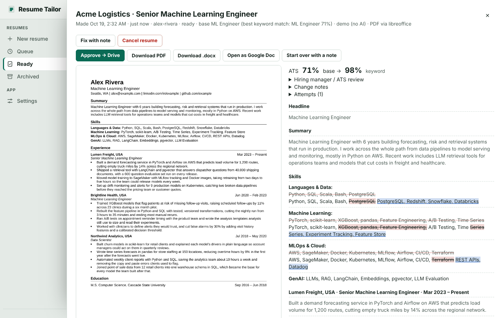
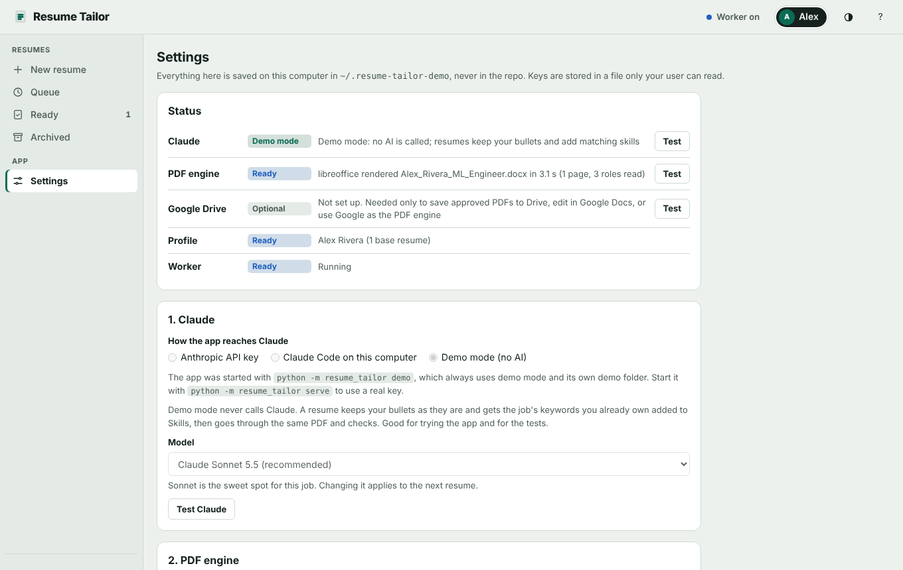
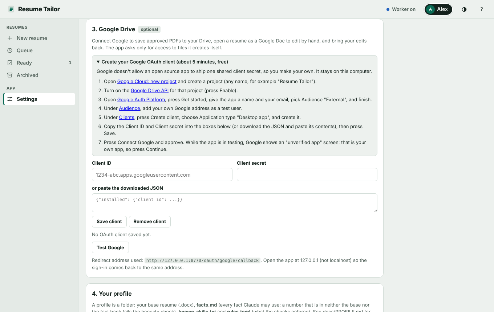
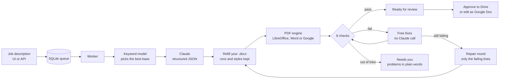

# Resume Tailor

Built in October 2026 for my own job search. This is the public version, with my personal resume data and keys removed.

Resume Tailor takes a job description and your master resume and gives back a tailored resume as a .docx and a
one-page PDF. Claude does the rewriting, but only with facts you wrote down in a fact bank, and every result goes
through eight checks before it reaches you: page count, layout, fonts, line fit, honesty, ATS keyword coverage,
writing rules and margins. You see what changed, line by line, and why.



## Why I built it

I was applying to a lot of machine learning roles, and tailoring my resume by hand for each one took longer than
I could keep up with. Every job description wanted the same experience described with its own keywords, in its
own order.

The obvious shortcut, pasting the job and my resume into a chat and asking for a tailored version, kept going
wrong in the same ways. It invented metrics and tools I had never used, it pushed
bullets onto a third line or the resume onto a second page, and it quietly changed my titles. I'd catch some of
it and miss some of it, which is worse than not using it at all.

So I wrote this. It refills my real .docx instead of generating a new one, so the formatting is mine. It only lets
Claude use numbers and skills that are in my base resume or my fact bank, and a machine check fails anything
else. It measures every bullet in the rendered PDF, keeps everything on one page, and shows me the keyword
coverage before and after, so I can tell quickly whether a resume is worth sending.

## What it does

- Paste a job description (or a Greenhouse, Lever or Ashby link) and pick a person; the resume is made in a queue.
- The best of your base resumes is picked by keyword score, then Claude rewrites the summary, skills and bullets
  under a strict contract: same roles, same bullet counts, same dates, only your facts.
- The PDF is checked against your base resume drawn by the same engine. Failures are fixed cheaply first (no
  Claude call), then Claude gets only the failing lines back with the rule each one breaks.
- You review it next to the base: every changed word is marked, with Claude's notes and the ATS score.
- "Fix with note" changes one thing you name in plain words. A skill or number the note states becomes yours for
  later resumes too.
- Approve saves the PDF to your Google Drive. "Open as Google Doc" lets you edit by hand, and "Get my Doc edits"
  brings the edits back and checks them again.
- Another program, such as a job tracker, can queue resumes and read results over an [HTTP API](docs/API.md).

## Quickstart

You need Python 3.11 or newer, poppler (it reads the PDFs for the checks) and a PDF engine. LibreOffice is the
free one that works everywhere.

```sh
# macOS
brew install poppler && brew install --cask libreoffice
# Ubuntu / Debian
sudo apt install poppler-utils libreoffice-writer

git clone https://github.com/vijayyarabolu/resume-tailor.git
cd resume-tailor
python -m venv .venv && source .venv/bin/activate
pip install -e .
```

Try it first with no accounts at all:

```sh
python -m resume_tailor demo
```

That prints a link like `http://127.0.0.1:8770/?token=...`. Open it. The demo uses its own folder
(`~/.resume-tailor-demo`), a made-up person called Alex Rivera, and a stand-in for Claude that keeps the bullets as
they are and adds the job's keywords Alex already owns. Paste the sample job from
`resume_tailor/examples/jobs/acme-senior-ml-engineer.txt` into New resume and it lands in Ready in a few seconds.

For real use:

```sh
python -m resume_tailor serve
```

Open the printed link, then go to Settings. The status panel at the top says what is connected, missing or
failing, with a Test button on each row.

1. Claude: paste an Anthropic API key, or pick "Claude Code on this computer" if you already use Claude Code.
2. PDF engine: Automatic picks LibreOffice when it's installed. Press Test PDF.
3. Google Drive (optional): follow the numbered steps to make your own OAuth client, paste its ID and secret,
   press Connect Google.
4. Your profile: create one, upload your base resume (.docx), and fill in `facts.md` and `rules.toml`. The demo
   profile is a full example; [docs/PROFILE.md](docs/PROFILE.md) explains every file.

Everything you set is stored in `~/.resume-tailor/` (keys in a file only your user can read). Nothing goes into the
repo folder.



## Accounts and what they cost

### Claude: an API key, because there is no sign-in for third-party apps

Anthropic doesn't offer OAuth for apps like this one, so the app uses an API key that belongs to you. Create it at
[platform.claude.com/settings/keys](https://platform.claude.com/settings/keys) after adding a payment method or
credit under Billing. Paste it in Settings; `ANTHROPIC_API_KEY` in the environment works too.

Pricing is pay as you go. Claude Sonnet 5.5, the default, is $2 per million input tokens and $10 per million output
tokens; Opus 5.5 is $4 and $20; Haiku 5.5 is $0.10 and $0.50 ([pricing page](https://platform.claude.com/docs/en/about-claude/pricing),
checked October 2026). One resume is 1 to 3 calls of roughly 10,000 tokens in and 5,000 out, so on Sonnet it costs
about 7 to 20 cents. At 100 resumes a month that comes to $7 to $20. Every attempt records its token
count and cost, shown under Attempts in the review panel. New accounts have sometimes come with a small trial
credit, but there is no ongoing free tier.

The alternative is the Claude Code backend: if Claude Code is installed and logged in on your machine (a Claude
subscription works), the app runs `claude -p` and needs no key. Without either, everything else still works and
new resumes wait in the queue with a message saying what to fix.

### Google Drive: a real Connect Google button, with your own OAuth client

Google doesn't allow an open source app to ship a shared client secret, so you create a free OAuth client of type
"Desktop app" in your own Google Cloud project (the Settings page walks through it in seven steps, about five
minutes). Connect Google then opens Google's consent screen: authorization code flow with PKCE, a loopback
redirect on the app's own port, and only the `drive.file` scope, which lets the app see the files it created and
nothing else in your Drive. Tokens refresh on their own; Disconnect revokes them at Google and deletes them here.
The Drive API is free for this kind of use.

Google is optional. Without it you lose Approve to Drive, editing in Google Docs, and the Google PDF engine.



## How it works



A few details I care about:

- Claude never writes a document. It returns JSON for the summary, skill lines and bullets, and Python puts the
  text into the existing runs of your .docx, so every font, tab stop and margin stays byte for byte what you made
  (`docxio.py`).
- The checks run on the real PDF. Bullets are located line by line with poppler, so a widow (a last line under a
  fifth of the width), a third line or a second page is caught exactly, against your base rendered by the same
  engine (`checks.py`, `basefit.py`).
- The honesty check is mechanical: every number in the new text must exist in the base resume or the fact bank,
  every skill must be in a base resume, `known_skills.txt` or something you confirmed in a note, and roles you
  mark as `era_jobs` can't mention LLM tooling that didn't exist yet.
- Repair is cheaper than regenerating. After the first attempt, only the failing items go back to Claude, with
  the rule each one breaks and everything else frozen (`repair.py`, `prompts.py`).
- The ATS model is a transparent keyword matcher (`ats.py`, `lexicon.json`): required skills count double, and
  the tailored score must not drop below the base. Real ATS vendors don't publish their scoring, so I don't
  pretend to model one.
- The worker sits in `select()` on a Unix socket when idle, so it uses no CPU until a job arrives. A rate limit
  pauses that person's queue until the reset time; nothing is dropped.

The code is standard library Python plus the `anthropic` SDK. The UI is plain HTML, CSS and JavaScript served by
the same process.

## What needs a Mac or extra setup

Nothing needs a Mac. On macOS with Microsoft Word installed you can pick Word as the PDF engine (it drives Word
through AppleScript, which is how my own base resumes were made). Everywhere else LibreOffice does the job, or
Google Docs once Google is connected.

Windows should work under WSL; I haven't tested native Windows (the worker uses a Unix socket).

The browser tests in `tests/ui/` need Node and Chrome or Chromium; they skip when either is missing.

## Running the tests

```sh
python -m unittest discover -s tests -t .
```

About 300 tests, all offline: Claude is faked or mocked at the HTTP layer, Google is a local fake server, and the
PDF tests use a committed PDF of the demo resume. One end-to-end test renders for real with LibreOffice when it
is installed. CI runs the same command on Ubuntu (`.github/workflows/ci.yml`).

## Limitations

- The base resume has to follow a readable layout: name, title and contact on the first three lines, then
  Summary, Skills, Experience and Education ([docs/BASE_RESUME.md](docs/BASE_RESUME.md)). A two-column or
  table-based resume won't parse.
- The keyword lexicon leans toward data and machine learning roles, because that's what I was applying for. Add
  your own terms in `~/.resume-tailor/lexicon.json`.
- The title rule (`headline_from_job`) knows five titles: AI Engineer, Machine Learning Engineer, Data Scientist,
  Data Engineer and AI/ML Engineer. Other fields should use a fixed `headline` or leave the title alone.
- Locations are read as US-style "City, ST".
- It's a local, single-user app. The token keeps other local users out, but don't put it on the internet.
- The checks keep a resume honest to your fact bank. They can't tell whether the fact bank itself is true.

## License

MIT, see [LICENSE](LICENSE).
